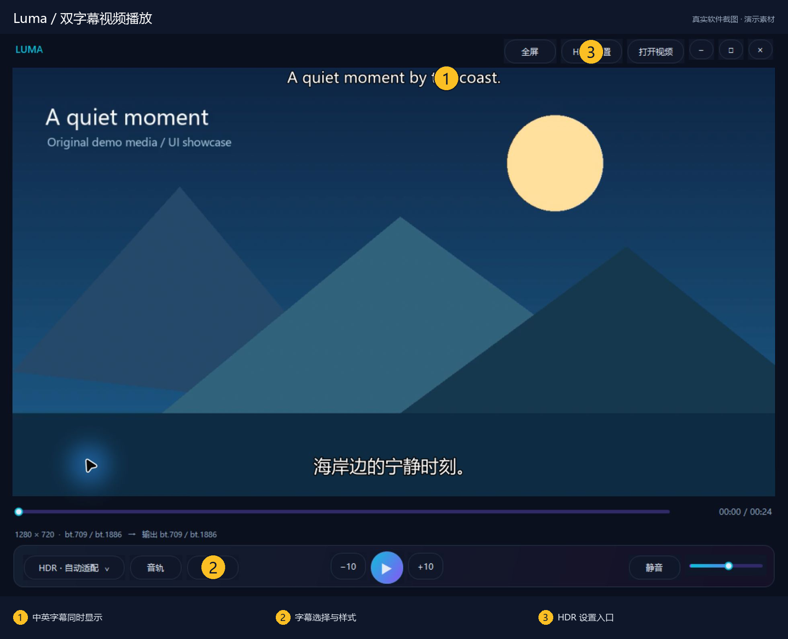
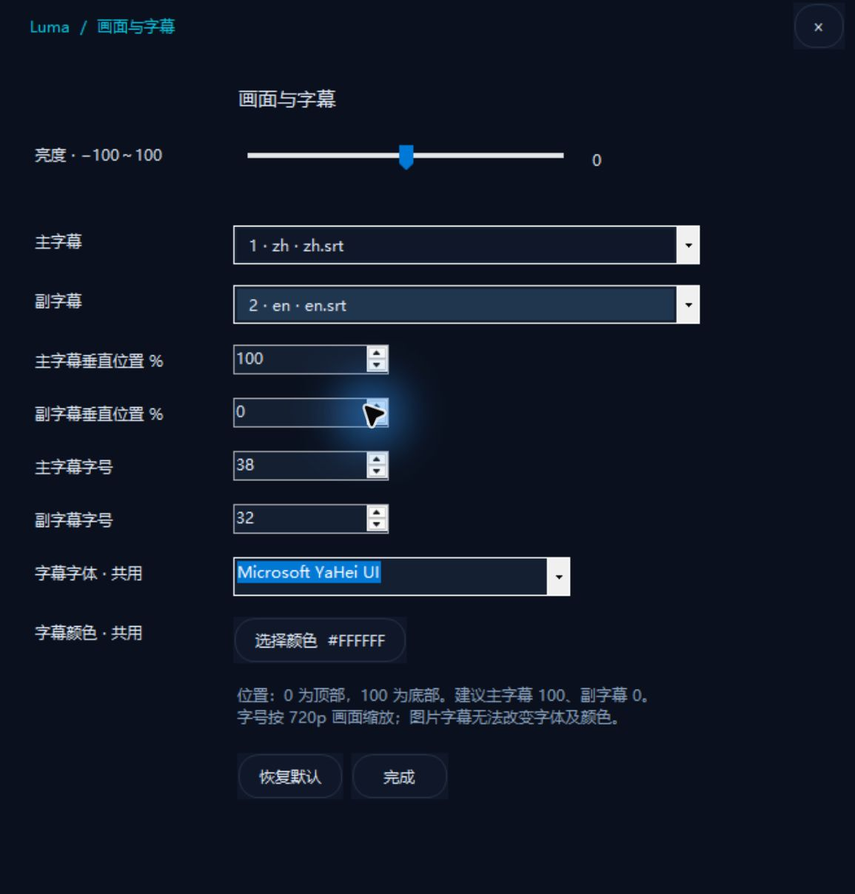

# Luma

**双字幕看视频，接着上次的位置继续。**

Windows 本地播放 · 双字幕 · HDR 色调映射。

[下载 Windows 版本](https://github.com/lyboxly-Matrix/Luma/releases) · [亮点](#项目亮点) · [快速上手](#快速上手) · [使用与开发](#使用与开发) · [反馈问题](https://github.com/lyboxly-Matrix/Luma/issues)



> 截图来自实际运行的 Windows 发布版；文档、视频和音频均为原创演示素材。编号为介绍标注。

## 项目亮点

| 亮点 | 能帮你做什么 |
| --- | --- |
| **双字幕对照** | 主、副字幕分别调整位置和字号，适合对照观看与语言学习。 |
| **适应屏幕的色彩输出** | 通过 mpv 处理 HDR；SDR 屏幕可使用 BT.2390 色调映射。 |
| **记住观看习惯** | 记录视频进度、字幕选择、音量和外观，下次打开恢复到上次位置并暂停。 |

## 跟着界面认识功能

### ① 主副字幕一起看，位置互不干扰

上图为真实播放界面：顶部英文副字幕、底部中文主字幕同时显示。演示视频为普通 SDR 内容；这张截图用于展示双字幕布局，不代表 HDR 显示效果。

### ② 在「字幕」里调整两套字幕



点击底部「字幕」打开「画面与字幕」。分别选择主字幕和副字幕，并单独调整垂直位置与字号；字体和颜色共用。图中实际选择了中文主字幕和英文副字幕。图片字幕无法改变字体和颜色。

### ③ 播放控制与画面设置各就其位

底部提供进度、前后跳转 10 秒、播放 / 暂停和音量；左下角选择 HDR 模式，顶部「HDR 设置」打开相关配置。程序会记住进度与字幕选择，重新打开视频后恢复位置并暂停。

## 快速上手

从 Releases 下载并解压运行包 → 放到可写目录 → 双击 `Luma.exe` → 拖入视频。

适用于 Windows 10/11 x64，使用系统 .NET Framework 4.x。首次启动会在同目录释放 `.luma-runtime` 内核缓存。

## 使用与开发

Windows 本地视频播放器，使用 C# WinForms 和 mpv，支持双字幕、HDR 色调映射与播放进度恢复。

## 使用

从 [Releases](https://github.com/lyboxly-Matrix/Luma/releases) 下载并解压运行包，双击 `Luma.exe`。适用于 Windows 10/11 x64，使用系统 .NET Framework 4.x，不需要安装 Node.js 或额外解码器。

首次启动会在程序同目录释放 `.luma-runtime` 内核缓存，之后可离线使用。请放在可写目录。

- Ctrl+O、打开视频按钮、拖放文件或命令行路径：打开视频。
- 空格：播放 / 暂停；左右键：前后跳转 10 秒；上下键：调节音量。
- 回车、F、双击画面：切换全屏；Esc：退出全屏，焦点在全屏悬浮控制条时同样生效。
- 窗口模式下，按住播放画面任意位置或标题区域并拖动即可移动窗口（左键）；支持显示缩放。双击播放画面仍可切换全屏；右下角可调整大小。
- 全屏悬浮控制条闲置约 2.5 秒后隐藏，移动鼠标重新显示。

## 功能

- 根据视频显示比例和屏幕工作区自动适配窗口。
- 记住上次视频、每个视频的播放位置及主副字幕选择，重新打开后恢复位置并暂停。
- 播放进度每 5 秒保存，暂停或退出时也保存。
- 双字幕分别调整位置与字号，共用字体与颜色；图片字幕不能更改字体和颜色。
- 亮度、HDR 模式、音量、静音、字幕样式和全屏状态保存在同目录 `luma-settings.json`。
- 深蓝界面、青紫进度条和统一的深色菜单。

迁移时请带上 `luma-settings.json`。视频移动后需重新打开。此文件包含本地视频路径及观看记录，不应上传到公开仓库。

## HDR 与音频

推荐保留 HDR 自动适配。HDR 视频可以在 SDR 屏幕上通过 BT.2390 色调映射观看；真实 HDR 输出需要屏幕和 Windows HDR 支持。强制 HDR10 不会让 SDR 显示器具备 HDR 能力。

Dolby Vision 色彩由 mpv/libplacebo 处理，并按设备输出 HDR10 或 SDR，不是电视端原生 Dolby Vision 信号输出。音频由 WASAPI 解码输出，未配置 Atmos 位流直通。真实 HDR 屏幕的高亮输出尚未验证。

## 构建

需要 Windows x64、系统 .NET Framework 4.x 的 C# 编译器，以及首次下载内核时使用的 Node.js（支持内置 fetch，18 或以上版本）和网络连接。

在项目根目录运行：

```powershell
powershell -NoProfile -ExecutionPolicy Bypass -File .\源码\build.ps1
```

脚本优先使用 `.luma-runtime/engine-20261015/mpv.exe`。没有缓存时，下载锁定版本内核、校验归档 SHA-256，并下载 7-Zip 独立解压工具。编译后的单文件程序输出为根目录 `Luma.exe`。构建前请退出播放器。

主要源码：`源码/Player.cs`；构建脚本：`源码/build.ps1`。程序未做代码签名。

## 许可与内核来源

Luma 源码采用 **GPL-2.0-or-later**，完整文本见 [GPL-2.0.txt](GPL-2.0.txt)。mpv 的版权与许可说明见 [mpv-Copyright](mpv-Copyright)，第三方来源见 [THIRD_PARTY_NOTICES.md](THIRD_PARTY_NOTICES.md)。

mpv Windows 构建：20261015，commit `492bae0768`。归档 SHA-256：

```text
f9becefe40e2a29d2ce5f3ab231ff094f9cf3e4038ff014cfe4a0c09ad90e79e
```


